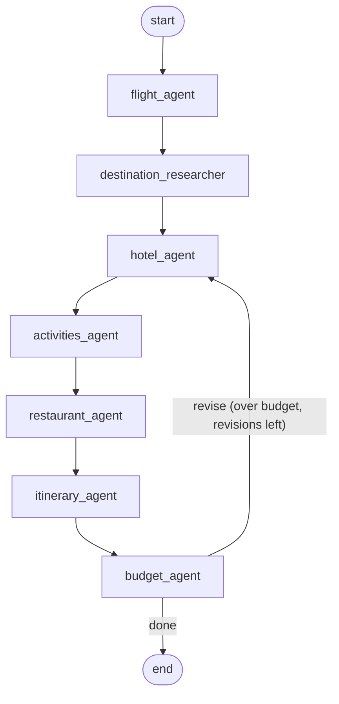

# Multi-Agent Travel Planner (LangGraph)

A multi-agent system that turns a trip request into a **day-by-day itinerary with a full budget check**. Seven agents share one state, research real options on the web, and loop back to cheaper choices when the plan goes over budget.

Example request: *Pakistan → Dubai, December 10–14 (5 days, 4 nights), 2 travelers, $2,000 budget, interests: food, shopping, beaches, sightseeing, 4-star hotel.*

**Stack:** Python 3.14 · LangGraph · Groq (`openai/gpt-oss-120b` via `langchain-groq`) · Tavily search with a DuckDuckGo (`ddgs`) fallback · Pydantic · pytest

---

## What it does

1. Prices flights, researches the destination, and finds hotels, activities and restaurants from live web search.
2. Builds a day-by-day plan that respects daily hour limits, groups activities by area, keeps arrival and departure days light, and attaches a nearby restaurant to each meal.
3. Adds up the real cost of the plan and compares each category with its share of the budget.
4. If the trip is over budget, it asks only the over-budget categories for cheaper options and runs again, up to 2 revisions.
5. Reports honestly: `within_budget`, `over_budget_final` (with how much over), or `incomplete` when an agent failed and a cost is unknown.

---

## Architecture



The revision loop goes back to the hotel agent, not the start. Flights are a fixed cost, and the destination research doesn't depend on the budget, so they run once.

### The agents

| Agent | Uses LLM | What it does |
| --- | --- | --- |
| `flight_agent` | No | Calls the flights tool, validates the result, marks flights as a fixed cost |
| `destination_researcher` | Yes | 4 web searches (areas, transport, best time, visa rules for the origin country) → structured research |
| `hotel_agent` | Yes | Searches hotels near the recommended areas. Code checks every price against the nightly cap and falls back to the cheapest valid option |
| `activities_agent` | Yes | LLM ranks activities by priority. Code includes them greedily within the activities budget and the trip's hour limit |
| `restaurant_agent` | Yes | Search queries follow the meal target. The LLM links each restaurant to a planned activity or the hotel by number, and code maps the number back |
| `itinerary_agent` | Yes | LLM groups activities into days. Code enforces the hour limits, repairs the plan, swaps in higher-priority activities, and picks restaurants for each meal |
| `budget_agent` | No | Adds up costs from the itinerary, checks each category against its cap, and decides whether to revise |

### Shared state

All agents read and write one `TravelState` (`state.py`), a `TypedDict` with:

- **8 inputs:** origin, destination, dates, duration, travelers, budget, interests, hotel preference
- **8 agent outputs:** each written by exactly one agent
- **4 control fields:** `revision_count`, `revision_notes`, `category_cuts`, and `errors`. `errors` uses an `operator.add` reducer, so every agent's errors are collected instead of overwritten.

Each agent returns only the fields it changes, and LangGraph merges them into the state.

---

## Key design decisions

**The LLM proposes, code verifies.** The LLM handles judgment (which hotel, which activities belong together, which restaurant fits), and code does all the math and enforces every rule. For example, the itinerary agent never trusts the LLM's day plan: it removes duplicates, enforces hour limits, and repairs or replaces the plan when needed. The output records who decided (`selected_by`, `planned_by`).

**One source of truth for business rules.** Day limits (3 / 6 / 6 / 6 / 2 h), meals per day type, budget shares and revision limits all live in `planning_rules.py`. Earlier versions had agents with different rules for the same thing, for example 30 h of activities planned against 23 h of real capacity.

**Budget shares of what's left after flights.** Flights are fixed, so caps are percentages of `budget − flights`: hotel 45%, activities 20%, food 25%, local transport and buffer 10%.

**Targeted revisions.** Each revision cuts the share only for the categories over their cap (`category_cuts`), 5 percentage points at a time, down to a floor. An earlier version cut every category and made the hotel worse when only food was the problem.

**Unknown is never zero.** A missing cost is `None`, and a failed agent's empty list counts as missing. So a failed agent can never produce a false "within budget".

**Guaranteed-valid structured output.** All LLM calls go through `invoke_structured()` in `llm.py`, using Groq's structured outputs with `strict=True` (constrained decoding), so the model can't produce invalid JSON or values outside the schema.

**Retries that match the error:**

- Rate limit (429): wait 30 s and resend the same prompt.
- Invalid answer: retry once with the error message as feedback.
- Request too large (413): stop immediately, because a retry can't help.

**Prompt size control.** Search snippets are trimmed to 400 characters in one place, the search tool, so all agents stay under the free-tier token limit.

**No hallucinated facts in code paths.** Sources and costs are attached by code, not by the LLM. Every price carries `price_evidence`, and the prompts forbid changing a price to fit the budget.

---

## Assignment requirements checklist

| Requirement | How it's met | Where |
| --- | --- | --- |
| 6+ agents | 7 agents (5 LLM agents, 2 code-only agents) | `agents/` |
| Shared state | `TravelState` with an error reducer | `state.py` |
| Conditional routing | `route_after_budget` → `revise` or `done` | `graph.py` |
| Budget revision loop | Back to the hotel agent, max 2 revisions, targeted cuts | `graph.py`, `agents/budget_agent.py` |
| At least 1 external tool | Tavily web search (+ `ddgs` fallback), plus a flights tool | `tools/` |
| Day-by-day itinerary | Hour limits, area grouping, light arrival and departure days, meals | `agents/itinerary_agent.py` |
| Budget calculation | Per-category totals against caps, with an honest status | `agents/budget_agent.py` |
| Error handling | Errors collected in state. Agents never crash the graph; fallbacks exist where possible | all agents, `llm.py` |
| Free APIs, hardcode if none | Groq and Tavily free tiers. No free flight API, so flights are hardcoded and labelled `"source": "hardcoded"` | `tools/flights_tool.py` |
| README | This file | |
| Example input/output | A saved run with 2 budget revisions | `examples/` |

---

## Setup

Requires Python 3.12+ (built and tested on 3.14, macOS on Apple Silicon).

```bash
git clone <your-repo-url>
cd travel_planner
python3 -m venv .venv
source .venv/bin/activate
pip install -r requirements.txt
cp .env.example .env
```

Then fill in `.env`:

```dotenv
GROQ_API_KEY=your_groq_key
TAVILY_API_KEY=your_tavily_key
GROQ_MODEL=openai/gpt-oss-120b
```

Both keys are available on free tiers: [Groq console](https://console.groq.com) and [Tavily](https://tavily.com).

## Usage

```bash
python main.py                 # $2,000 example
python main.py --budget 1400   # tighter budget, usually triggers a revision
python main.py --help
```

The terminal shows each agent as it finishes, so you can watch the revision loop, then a trip summary, a budget table, and all errors and warnings. The full input and output are saved to `examples/dubai_input.json` and `examples/dubai_output.json`, overwriting the previous run.

A run makes about 15 web searches and 5 LLM calls per pass. On Groq's free tier, it may pause for 30 s when it hits the rate limit.

## Tests

```bash
python -m pytest tests/ -v
```

There are 33 tests. They make no API calls: LLM-based agents are replaced with fakes using `monkeypatch`, so the tests are free, fast and deterministic.

| File | Covers |
| --- | --- |
| `test_planning_rules.py` | Day limits, meal counts, budget shares, targeted cuts, floors |
| `test_budget_agent.py` | All 4 outcomes, targeted cuts, failed-agent detection, no mutation of input state |
| `test_itinerary_agent.py` | LLM failure fallback, repairing plans that break limits, duplicate numbers, priority swap, consistent text, meals by day type, cheaper restaurants |
| `test_flight_agent.py` | Known and unknown routes, invalid input |
| `test_graph.py` | Router, single pass when within budget, loop runs at most `MAX_REVISIONS` times |

---

## Example runs

| Budget | Result | Revisions | Notes |
| --- | --- | --- | --- |
| $2,000 | $1,660.70, within budget | 0 | The itinerary LLM failed this run; the code fallback produced the plan |
| $1,500 | $1,426.12, within budget | 0 | |
| $1,400 | $1,366, within budget | 2 | The hotel was over its cap; only the hotel share was cut, twice. **Saved in `examples/`** |

**Results differ between runs.** Search results and LLM answers change, so the same input can need a revision on one run and not on another. That's why the revision loop is proven with deterministic tests (`test_graph.py`), not with live runs.

---

## Known limitations

These are things I found by evaluating the system's own output, not just by building it.

1. **Prices aren't verified.** Prices come from search snippets, which often show "from" prices, other dates or other currencies. The LLM converts currencies itself. Under tight budgets, the loop pushes toward suspiciously cheap options; the $1,400 run accepted a 4-star hotel at about $25/night in December, which is almost certainly not a real rate. **This is the most important limitation.**
2. **LLM text isn't checked.** `reasoning`, `distance_to_attractions` and some general-knowledge facts can be wrong. Seen in runs: Downtown and Dubai Marina called "adjacent", a JBR hotel "1.2 km from Dubai Mall", and the UAE weekend given as Friday (it moved to Saturday–Sunday in 2022).
3. **Flights are hardcoded** at $500 per person round trip (no free flight API was available).
4. **Local transport is a fixed estimate** ($10 per person per day). At low budgets it's larger than its 10% share, so it should be subtracted up front like flights.
5. **Activities that include a meal** (a desert safari BBQ, food tours) still get a restaurant meal at the same time, so food is counted twice.
6. **Areas are matched by exact text.** "Al Fahidi / Old Dubai" and "Al Fahidi Historical Neighborhood" count as different areas.
7. **The priority swap is greedy.** It puts priority above area grouping, and some daily capacity stays unused.
8. **No clock times:** activities are ordered within a day but have no start or end times. Breakfast isn't planned.
9. **Revisions re-run the hotel and activities agents** even when only food was cut, which costs API calls and can change those choices.
10. **Errors accumulate across revisions,** so one warning can appear once per pass.

## Future work

- **Price-evidence check:** require a short quote from the snippet and have code verify that it really appears in the search text. Unverified prices get flagged.
- A real flight-price API and a geocoding API for real distances and area matching.
- An `includes_meal` field on activities.
- Skip re-running agents whose budget wasn't cut.
- Pass every trip input through the command line, and add tracing (for example LangSmith).

---

## Project structure

```text
travel_planner/
├── main.py                  # entry point: runs the graph, prints a summary, saves examples
├── graph.py                 # LangGraph nodes, edges and the revision router
├── state.py                 # TravelState + make_initial_state()
├── planning_rules.py        # all shared business rules (day limits, meals, budget shares)
├── llm.py                   # Groq client + invoke_structured() with strict output and retries
├── schemas.py               # Pydantic models for every LLM output
├── agents/                  # the 7 agents
├── tools/
│   ├── flights_tool.py      # hardcoded flight prices
│   └── web_search_tool.py   # Tavily → ddgs fallback, ad filter, snippet trimming
├── tests/                   # 33 pytest tests, no API calls
└── examples/                # saved input/output JSON from the $1,400 run
```

## Lessons learned

- Handling an error locally isn't enough: the agents after it must know the data is missing.
- A revision loop only works if each agent can actually change its output when asked, and only if the prices it optimises are reliable.
- Only retry errors a retry can fix.
- When code changes something an LLM produced, every piece of text that depends on it must be updated too.
- A failing test doesn't automatically mean the code is wrong; check the test's reasoning as well.

---

*This is a portfolio project. Prices are estimates from web search, not quotes. Always confirm visa and entry rules with official government sources before travelling.*
